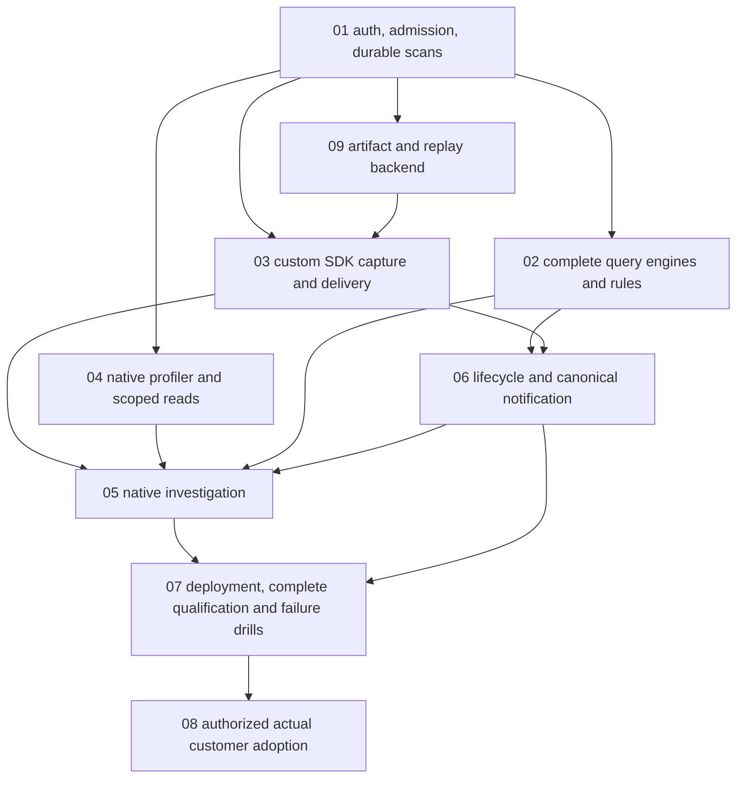

# Soundpost shared plan index

Date: 2026-11-03. **APPROVED FOR IMPLEMENTATION.** Aryn Yklas approved the [complete design](../specs/2026-11-03-soundpost-design.md) and [contracts](../specs/2026-11-03-soundpost-contracts.md), selecting subagent-driven execution with m1 implementers and m2 reviewers. Approval permits product implementation and dependency installation, not public publication or customer infrastructure changes.

## Sources of truth and direct clarification

1. [Selected requirements](../specs/2026-11-03-soundpost-requirements.md), including this session's direct owner clarifications.
2. Approved shared design and C01–C12 contracts. Technical choices and numerical defaults are implementation requirements pending real qualification, not measured capabilities.
3. The subsystem plans below decide concrete implementation paths/tests from those contracts.
4. [Active research digest](../../research/2026-11-03-primary-source-research.md); archived comparisons are not work items.

**Soundpost defines its own contracts throughout.** Full PromQL/LogQL language semantics remain selected; no Sentry/OTLP/upstream HTTP/API/UI compatibility obligation exists. Input translators are isolated migration interfaces, never the native architecture or production evaluator fallback.

## Plans and integration owners

| Plan | Deliverable and owned modules | Tasks |
|---|---|---:|
| [01 Durable isolated engine](2026-11-03-01-durable-engine.md) | Auth/session/control, typed admission/receipts/routing/reservations, WAL/segments/indexes/scans/committed subscriptions, replication/fences/snapshots, deletion/backup authority/restore | 9 |
| [02 Own query engines](2026-11-03-02-query-engines.md) | Complete versioned PromQL/LogQL parsers/evaluators/templates, input decoders, own query/discovery/live, rules/recording output and semantic conformance harness | 12 |
| [03 SDK/capture/replay](2026-11-03-03-sdk-capture.md) | Python and TS browser/Node/Bun SDKs, delivery/privacy/context/hooks/HTTP/DB/jobs/build upload, owned replay recorder/viewer and runtime supplements | 9 |
| [04 Native Linux profiling](2026-11-03-04-native-profiling.md) | Fixed privileged perf acquisition, sanitized ring ABI, CPU/off-CPU correlation, generation/symbol/coverage, profile export/read, real kernel qualification | 9 |
| [05 Investigation UI](2026-11-03-05-investigation-ui.md) | Native React UI, C11 workflow HTTP projections/actions, artifact HTTP adapter, critical-path analysis, masked replay/profile integration/accessibility | 9 |
| [06 Incident/notification workflow](2026-11-03-06-incidents-notifications.md) | Releases/grouping/issues/jobs/ordered conditions, human incidents, canonical urgency/queue/digest, outbox/providers and ownership cutover state | 9 |
| [07 Deployment/conformance](2026-11-03-07-deployment-conformance.md) | Single/distributed packaging, real host/system collection, reference app estate, orchestration of existing semantic/runtime/native gates, failure drills and release artifacts | 8 |
| [08 Customer adoption](2026-11-03-08-adoption.md) | Authorized current evidence, source shadowing, all actual application journeys, policy parity, isolation/outage gate, one-owner cutover/rollback and retained history | 7 |
| [09 Artifact/replay server evidence](2026-11-03-09-artifacts-replay.md) | Actual protected artifact bytes/metadata, owned source-map engine/sandboxed symbolication, reference retention and replay chain/read modules | 6 |

The numbered plans are ownership labels, not a requirement to finish each entire plan serially. Task interfaces and the dependencies below determine scheduling. Plan09 closes real backend ownership for SDK/UI integration; it is required, not an optional follow-up.

## Concrete file ownership and acyclic seams

- `internal/model` is a leaf of shared typed identities/telemetry. Consumers own narrow dependency interfaces; `internal/app` wires implementations. Control stores leaf DTOs and cannot import query/rules/incident implementation packages.
- Plan01 owns `internal/auth/service.go`, all real login/session/OIDC/elevation logic, and `httpapi.RegisterSessionRoutes` in `internal/httpapi/session.go`. Plan05 consumes them and owns browser session forms, never a second auth implementation.
- Plan01 owns C05 `Scan` and committed `Subscribe`. Plan02 owns SSE/live filtering/discovery/query caches. No scan polling substitute.
- Plan02 alone owns `internal/rules/*`, `internal/control/rule_evaluation.go` and the **internal** recording/condition output outbox. Plan06 consumes that module and owns condition ordering plus **external** notification outbox. Their payloads/storage are distinct.
- Plan02 alone owns `internal/conformance/query`, `conformance/query`, `profiles/query` and `cmd/soundpost-querycheck`; plan07 orchestrates required release matrix rows without a second comparator, loader or inventory.
- Plan09 owns `internal/artifacts`, `internal/sourcemap`, `internal/symbolicate`, `internal/replays`. Plan03 owns build uploader/recorder/viewer; plan05 owns HTTP artifact/investigation adapters and authorized rendering; plan04 owns `internal/profiles`. No canned backend mappings or fake replay data can satisfy integration.
- Plan05 owns `internal/httpapi/workflow_types.go`, `investigate.go`, `actions.go` and related native views. Plan01 owns generic capability/export/link/isolation infrastructure; final denial tests integrate the actual UI handlers after delivery.
- Plan03 Task1 owns the root TS workspace definition/install lock and shared packages; plan05 first feature adds `web` app config using that workspace. Package test runtimes may differ to exercise Node/Bun truthfully; dependency management uses one workspace lock, not conflicting per-package install conventions.
- Plan07 owns the shipped `cmd/soundpost-agent` host collectors and deployment files. Plan04 owns the separate `soundpost-perf-acquire` helper and its explicit privilege service; no blanket privileged product server.
- Shared CLI/smoke files created by earlier tasks are modified by later owners, not recreated. Fixture subtrees are plan-specific; reference applications in plan07 reuse SDK/native fixture contracts instead of becoming a second SDK implementation.

## Dependencies and cumulative vertical gates

This diagram is module-level integration, not a demand that SDK initialization wait for symbolication. Detailed scheduling:

1. **Durable isolated path:** plan01 Tasks1–4, then full three-node/fence/recovery Tasks6–9. First path must ingest/read exact approved data with real credentials/restart, not scaffold endpoints. Plan01 Task5 denial infrastructure grows to include later real secondary readers. No single-host progress is a distributed success claim.
2. **Language engines and input migration:** plan02 Tasks1–8 over real scans, then own query/live/rules Tasks9–12. Exhaustive ledgers retain all profile scope even before gates pass. Plan07 later reruns the same harness against release artifacts/topologies.
3. **Application evidence:** plan03 Tasks1–5 can run beside query work after C03 freezes. Plan09 Tasks1–4 plus plan06 Tasks1–3 provide the actual artifact/symbolication/issue/job backend needed by plan03 Task6. No future dependency is substituted with a mocked passing integration.
4. **Replay and native:** plan03 Tasks7–8 recorder/viewer plus plan09 Task5 server chain complete replay. Plan04 Tasks1–6 acquire/correlate independently, then Tasks7–9 integrate durable reads/privacy/runtime qualification. Runtime-only samples never satisfy native acceptance.
5. **Response and investigation:** plan06 Tasks4–9 consume existing rules/evidence and produce canonical workflow. Plan05 Tasks1–9 consume actual modules. Browser scopes, conflicts/gaps/unsupported states and all real journeys must be exercised, not just snapshots/unit tests.
6. **Distribution and release:** plan07 Task1/2 packaging can progress as modules become real; Tasks3–8 integrate host sources, full reference journeys, all language/runtime/native/security budgets and actual failure drills. Unimplemented promised surfaces block release.
7. **Adoption:** plan08 read-only intake can be prepared early under authorization, but actual cutover waits every product gate and current customer acceptance. Product approval never authorizes production actions implicitly.

## Requirement-to-implementation coverage

| Requirement | Owning plan/tasks and required evidence |
|---|---|
| R01 Apache/self-hosted/included capabilities | All first-party plans;07 T1/T8 dependency/provenance/OSS artifact gate |
| R02 Native unified investigation/all environments |05 T1–T9;06 T1–T9;07 T1–T4 host/container/VM/app evidence |
| R03 Owned ingestion/index/storage/query/evaluation |01 T2–T9;02 T1–T12; no production oracle route/dependency |
| R04 Full PromQL/LogQL language semantics |02 T1–T12 exhaustive profiles/corpus/gates;07 T5 release-matrix runs |
| R05 Custom Python/TS SDK/protocol |03 T1–T6;01 T2–T3 admission;09 real artifact backend |
| R06 Metrics/logs/traces/errors/maps/releases/jobs |01 T4;02 T8–T11;03 T2/T4–T6;05 T4–T7;06 T1–T4;07 T3/T4;09 T1–T4 |
| R07 Strict opt-in pre-buffer replay |03 T7–T8;09 T5/T6;05 T8;07 T6 canary and actual browser evidence |
| R08 Own native Linux CPU/off-CPU sampler |04 T1–T9;07 T6/T7 real kernel/workload/privacy/loss/overhead proof |
| R09 Truthful runtime/browser/Bun support |03 T4/T5/T9;04 T9;05 T8;07 T6; unsupported is never zero |
| R10 Org/team/project/admin isolation |01 T1/T5/T8/T9;02 T9/T10;04 T7;05 T1/T2/T4/T8;09 T1/T4–T6;07 T7 denial matrix |
| R11 Both modes/durable ACK/one-node survival |01 T3/T6/T7;07 T1/T2/T7 actual-process/disks/ACK reconciliation |
| R12 Separate alert/issue/incident/job history |06 T1–T5;02 T11;05 T3/T4/T7 conflict/history/freshness evidence |
| R13 Urgent plus queue/digest/best-effort admins |06 T6–T8;05 T3;08 T4 intentional policy comparison |
| R14 ACK/reminders/impact/snooze semantics |06 T5–T7;05 T3; actual timers/versions/outbox crash evidence |
| R15 Structured templates/restricted raw |01 T2;03 T1/T2;07 T3; source-reader visibility fingerprint denial |
| R16 Privacy throughout buffers/artifacts/replay/native |03 T1–T9;04 T3/T4/T6/T8;09 T1–T6;07 T6 |
| R17 Adapters/verified canonical cutover/deadman |02 T8;06 T9;07 T7;08 T1–T6 |
| R18 Read-only retained legacy history |08 T1/T7;06 T9 visible boundary/obligations, no automatic importer/deletion |
| R19 Actual gateway→dependency/Bun |03 T5/T9;05 T6;07 T4;08 T3 real customer acceptance |
| R20 Actual frontend→API→DB/mapped release |03 T4–T6;09 T1–T4/T6;05 T4/T6;07 T4;08 T3 |
| R21 Actual failed job→retry/recovery |03 T6;06 T3;05 T7;07 T4;08 T3 |
| R22 Cross-org and pipeline/failure/recovery drills |01 T5–T9;04 T8/T9;06 T7/T9;07 T7;08 T5 |
| R23 Shared spec plus separate complete plans | This index, design/contracts and plans01–09; every planned file has an integration owner |
| R24 Approval/execution/production separation | Draft status and gates in every plan; approval record required before execution;08 per-environment authorization |

## Review and completion standard

[Review record](../specs/2026-11-03-soundpost-review.md) records actual design checks and fixes, not product test results. Plan commands are future instructions. Each task must first produce a meaningful failing behavior, implement the declared interface, pass the specific checks, exercise a real smoke scenario, update actual docs/changelog and commit the scoped result. Do not retain wording/source-copy/incidental-default tests or mocks as acceptance. Generated conformance cases and true failure regressions are legitimate behavior coverage.

Every subsystem release gate is cumulative: no placeholders, unimplemented replay/SSO/native sampling, fake source-map output, hidden cross-org lookups, subset language claim or partial architecture can be reported as the whole product. If a numerical budget or required environment fails, optimize or obtain explicit requirement revision; do not silently narrow scope.

## Owner approval and execution

Aryn Yklas approved the complete design/contracts on 2026-11-03, including the Go/React stack, embedded replicated metadata, 64-slot ownership, profile versions, browser/native limits, privacy/retention/restore contract and numerical policies/budgets.

Execution: **Subagent-driven**, using **m1 (GPT-6.1 Sol)** implementers and **m2 (Qwen 3.8 Flash Next)** reviewers, with one integration owner and cumulative real-smoke gates.

No GitHub repository/remote has been created or published by this design task. Local design history is separate from architecture approval and public release authorization.
