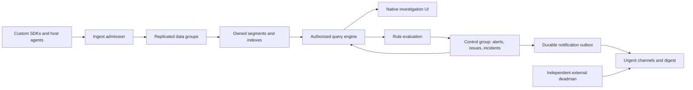

# Soundpost product architecture and design

Date: 2026-11-03. **Proposed for owner approval; not approved for implementation.** Author: Aryn Yklas. Technical choices below are the design author's proposals, not inherited owner decisions. The owner has authorized repository initialization, requirements preservation and design preparation only.

Normative intake: [selected requirements](2026-11-03-soundpost-requirements.md). Evidence: [active research digest](../../research/2026-11-03-primary-source-research.md), with the original reports archived separately. Module interfaces: [contracts](2026-11-03-soundpost-contracts.md). Execution map: [plan index](../plans/2026-11-03-soundpost-plan-index.md). Approval of this document must include the contracts, support limits and proposed budgets; a green document review is not product acceptance.

## 1. Intent, scope and anti-goals

Soundpost is an independently deployable Apache-2.0 observability and response product. An administrator moves from a user-visible failure to its release, error group, distributed critical path, relevant system state, masked replay and CPU/off-CPU evidence without switching products. All environments use the same organization/project/service/environment identities. An environment is an attribute, not an authorization mechanism.

The entire selected scope remains a release obligation. Vertical milestones supply real independently verifiable behavior; none is branded the complete product until the final conformance and customer acceptance gates pass. No cloud account, paid SSO tier, external telemetry database, upstream evaluator fallback or Kubernetes-only collection is required. Soundpost is not an AI log-content collector, remote debugger, memory-dump collector, staffed on-call service or automatic production remediation system. Initial workflows are notification/queue/ownership, not arbitrary remote code execution.

**Direct owner clarification, 2026-11-03:** define Soundpost's own contracts throughout, not Sentry-compatible or other-product-compatible backend interfaces. The owner separately confirmed that full PromQL/LogQL **language semantics** remain required. Upstream HTTP APIs, wire envelopes, schema/UI copies and product workflow parity are not requirements. Migration adapters are deliberately scoped bridges, not the native architecture.

## 2. Proposed technical decisions

| Decision | Proposal and rationale | Alternative not selected |
|---|---|---|
| Server/query/native collector | Go 1.27.3, one module, owned engine packages, separate executable entry points. Standard-library RE2 semantics and Go templates reduce LogQL semantic risk; bounded columnar loops avoid per-row object graphs. | Rust has attractive native memory control but would add a Go-template compatibility interpreter or second language. Neither is an inherited owner choice. |
| Web UI | TypeScript strict mode, React, Vite; built assets embedded in server. Native investigation UI, no embedded Grafana/Sentry. | Server-rendered pages simplify initial packaging but make synchronized trace/replay/profile views harder. |
| SDKs | Owned Python packages and TypeScript browser/Node/Bun packages, runtime APIs only; owned bundler integration and artifact uploader. | Sentry/OTel wrappers do not satisfy the selected contract. |
| Wire | Soundpost v1 JSON batches over HTTPS, gzip optional. Integer nanoseconds and float bit patterns use explicit string/bit encodings. | Protobuf is not needed for the initial bounded batches; no OTLP compatibility is implied. |
| Consensus | Apache-2.0 etcd Raft library, not etcd telemetry services; owned stable-log/snapshot integration and telemetry state machines. | Inventing consensus increases failure risk; an external queue duplicates durability state. |
| Metadata primitive | MIT bbolt embedded ordered KV for metadata, Raft stable state and manifests; product-owned records/index keys. | PostgreSQL is permitted but would add a separately operated HA database. No external telemetry store is selected. |
| Telemetry storage | Owned WAL, immutable columnar segments, typed indexes, query/evaluation and compaction. Local replicated disks are authoritative in both modes; S3-compatible storage is optional encrypted backup/export, not an ACK prerequisite or sole cold-data copy. | Prometheus/Loki/ClickHouse/OpenSearch cannot replace the selected owned engines. |
| Native sampling | Owned Linux userspace perf-event/ring-buffer collector. No eBPF programs or raw stack dumps in the design. | GPL-only eBPF helper paths and DWARF stack-byte capture add licensing/privacy risk. |
| Distribution | Single binary plus SDKs; systemd/container and Compose single-host recipes; three-node distributed Compose for drills and Kubernetes StatefulSet/Helm production packaging. | Mandatory Kubernetes excludes supported environments. |

Go 1.27.3 is present in the public release metadata inspected for this design; no Go compiler is installed locally and none was installed for this design task. Exact external module/package versions, licenses and hashes are locked during the first approved build task; dependency upgrades must preserve profile semantics. Compiler upgrades cannot silently change Go-template or regex observable behavior. bbolt and Raft are generic infrastructure primitives, not borrowed telemetry indexing/query engines.

## 3. Process and module topology

`soundpost serve --mode=single` hosts HTTPS ingestion, authenticated read/control interfaces, one-voter metadata/data groups, query workers, rule workers, notification outbox and embedded UI. `soundpost-agent` collects approved host metrics/log sources and native profiles; it is not required to run the server. The native collector has a narrow privileged acquisition process and an unprivileged sanitizer/export process connected by a bounded local socket. Both are first-party code. No process accepts remote commands to inspect memory or enable arbitrary perf probes.

Distributed mode uses three or more server nodes. Independent disks and stable node identities host one three-voter control group plus 64 fixed logical data slots, each with three voters on distinct nodes. The control group owns organizations, credentials, policies, layout placement, global quota reservations, lifecycle state, audit and outbox. Slots may start lazily but their hash identity never changes; moving replicas uses joint membership, not rehashing accepted records. Stateless routing/query can run on these or additional nodes. There is no external metadata primary. Internal RPC uses installation-issued mTLS certificates and role-bound endpoints.

Each package hides a deep module behind the small interfaces in the contracts document. Authorization context is required at the storage/query seam, including internal workers; adding a label matcher is not authorization. Single/distributed modes implement the same interfaces with different replica membership, not separate products or a reduced feature set.

## 4. Identity, authorization and audit

IDs are opaque 128-bit random identifiers except trace IDs (128 bits) and span IDs (64 bits). Every persisted user record belongs to one installation and one organization; project-bound records additionally carry a server-validated project ID. Service/environment/release/job IDs are namespaced by project. IDs, URLs, tenant headers, trace links and source labels never grant access.

User login supports local accounts with Argon2id passwords, recovery codes and TOTP, plus OIDC Authorization Code with PKCE, state, nonce, issuer/audience checks and explicit configured provider-to-organization/team mappings. No implicit organization join from an email domain or arbitrary token claim. SAML is not promised; OIDC is the proposed included SSO interface. HTTP-only secure same-site cookies, CSRF defenses, session rotation/revocation and short-lived artifact read grants apply. API tokens are random secrets stored as keyed hashes, scoped by org, project and action, independently revocable, with expiry.

Permissions are `telemetry.read`, `telemetry.ingest`, `raw.read`, `artifacts.read`, `artifacts.write`, `replay.read`, `profiles.read`, `issues.write`, `incidents.write`, `rules.write`, `policy.write`, `org.admin` and `instance.admin`. Team grants explicitly select projects/actions; org membership alone grants no project data. Restricted raw additionally needs its named-source reader grant. Browser source keys are public write-only identifiers with rate limits/origin allowlists, never read tokens or trusted-client proof.

An organization-scoped Scope is constructed only by auth code and cannot be decoded from telemetry. It carries principal, current policy epoch and a VisibilityFingerprint covering all effective project/action/named-source reader entitlements. Every query/cache/index/discovery/exemplar/live/source-map/replay/profile/artifact/export path binds this identity; shared project actions alone cannot share a restricted-source cache. Aggregation follows authorization filtering. Unauthorized trace segments disclose no project name/count/timestamp. Pagination/live replay/export grants use the same visibility binding.

Instance-wide investigation requires an instance-admin role, fresh reauthentication, explicit reason and a 15-minute elevated session. Each selected organization obtains a separate scope; there is no magic wildcard bypass for raw record lookups. Cross-org results name their org visibly. An elevation audit record is committed before use; per-query audit is durable before returning data. If audit cannot commit, elevated reads fail closed. Grants/revocations increment an org policy epoch; live streams and queries revalidate at least every 5 seconds and before each chunk. Cached results require a current epoch. Link sharing conveys no bearer access.

Audit includes principal, action, target identifiers, reason, policy epoch, outcome, request ID and time, but no raw query literals or telemetry content by default. Append-only audit retention is 365 days by default; export verification detects missing sequence ranges. A machine root or disk administrator remains outside application-level isolation; this is not a confidential-computing claim. TLS and volume encryption plus separately restricted backup keys are operating requirements.

## 5. Capture privacy and source policy

The default source class is `structured`: registered template IDs and typed allowlisted fields only. Template registration requires a project policy administrator; placeholders declare type, maximum size and sensitivity. Unknown keys are dropped before SDK buffering; unknown templates are rejected and counted. Uncaught exceptions still produce class, sanitized code frames and mechanism when the message is disallowed. Do not call `repr`, object serializers, getters or exception `str()` merely to scrub their output. Python code/frame identities are read without locals/globals/source lines.

Raw logs/messages require a named `restricted_raw` source policy with owner, rationale, field/source limits, reader grant, expiration and shorter retention. Agent acquisition filters approved sources before copying to the application queue. Transient input buffers from a log source may contain source bytes and must be bounded and overwritten/released; they are not persisted before policy transformation. Restricted raw read permission is additional to telemetry read and is never granted to browser write keys. Unknown syslog/journal/file streams are not silently accepted as safe text.

Default exclusions cover bodies, headers/cookies, URL query/fragment, credentials, prompts/responses, SQL text/parameters, user-supplied exception values, locals/heap/object values, console arguments, source context and arbitrary attributes. Route templates, operation codes, numeric duration/status, dependency class and approved resource identities remain useful. URL collection uses registered origin aliases plus path templates, not a guessed regex scrub. Frame identities are normalized to project-relative artifact paths or stable module IDs; absolute home paths are stripped locally. Profile symbols and uploaded source artifacts have separate policies.

Policies are signed by the installation, versioned and bound to a source/project. SDKs ship a restrictive built-in baseline and can narrow it locally. Expired/unavailable policy disables optional capture rather than allowing raw data. A remote policy cannot turn on bodies, heap dumps, arbitrary getters or unmasked replay; broader restricted-source collection requires explicit deployment configuration. Diagnostics use reason codes/counters, not rejected payloads. Server policy validates again before admission and quarantines only safe structured diagnostics, not raw rejected data.

## 6. Wire admission, idempotency and delivery

The custom `POST /ingest/v1/batches` accepts a single project/source per batch, version, producer ID, batch ID, policy revision and up to 512 typed records. Maximum compressed body is 1 MiB and decompressed body 4 MiB; a record is at most 256 KiB. JSON duplicate keys, invalid UTF-8, unsupported major versions, unknown record kinds and integer overflow are errors. Unknown extension fields are discarded before persistence. Decimal-string nanoseconds, decimal uint counters and explicit IEEE-754 hex bits prevent JS number precision loss, histogram/staleness corruption and JSON NaN ambiguity.

Admission is **atomic per batch**, not across requests/projects. Canonical record owners (series/stream/trace/run/replay/profile/event) map to 64 fixed slots; SDK/adapters partition before assigning batch IDs. Mixed-slot batches reject entirely. Same-series equal-time/type/value duplicates collapse; different values conflict at ordered state-machine apply. Durable global quota reservations precede data proposal and remain charged on ambiguous outcomes until cancellation fencing proves no commit. ACK waits durable commit/apply. `(org,project,source,producer,slot,batch)` receipts persist 7 days with original per-signal retention deadlines/minimum; changed content is 409. Authenticated historical receipt lookup is separate from admission, does no normalization/reservation/append, and can report the unchanged receipt after expiry/historical deletion. Invalid/revoked credentials and retired scopes are outside that guarantee; a historical response is not a new post-revocation write.

Responses: 200 with original/new durable receipt and shard/commit cursor; 400/413/415/422 terminal validation/admission errors with bounded reason codes; 401/403 invalid source; 409 content conflict; 429 or 503 retryable with `Retry-After`; timeout/network failure is ambiguous and retried with the same identity. A quota reservation that fails or a minority leader cannot return success. Multi-batch uploads may partially succeed by batch; the SDK retains only unacknowledged batches. A receipt is not an assertion that downstream indexing, rule evaluation or notification has completed.

Default SDK memory queue is 2 MiB or 1024 records, whichever first; one in-flight batch per producer+slot lane, jittered backoff 250 ms to 30 s, maximum event age 5 minutes and shutdown flush 2 seconds. Disk spooling is explicit opt-in, encrypted and policy-bound. Overflow drops low-priority timing/replay first, then old unacknowledged data with counters; no false ACK or application blocking. Process kill/page exit can lose unacknowledged data; beacon/keepalive is not durable delivery proof. Export failures cannot alter app output or fatal exit behavior.

Ingest freshness (committed/applied/indexed cursors), producer capture/drop counters and unsupported-capability records are distinct. Absence of records without a healthy producer/fresh cursor is `unknown`, not zero errors or recovered health.

Revocation/restrictive policy/deletion uses the durable barrier saga in contracts C12: control marks the scope closing, denies affected new grants/reads and derived effects; all relevant data slots commit epoch/tombstone fences; control records their cursors and completes the operation. HTTP202 while fencing is not success. Old-epoch writes ordered before a slot barrier can finish before operation completion, but none can commit successfully after completed revocation. Unavailable groups block completion. This defines the cross-group ordering instead of pretending a control ReadIndex and unrelated data append are one transaction.

## 7. Durable engine and distributed failure semantics

### 7.1 Stable write ordering

For each group, an owned length/checksummed WAL stores Raft term/index/entry bytes. A follower persists entries and hard state with `fdatasync`/equivalent before acknowledging persistence. The leader counts only durable replica responses. Three-voter groups commit on two durable copies. Stable-state term/vote/commit ordering follows the Raft library contract; Ready batches are not advanced until required writes/sends/applies complete. Single-host uses one voter with the same write/sync path. Fsync or full-disk failure returns no ACK and marks the node unready.

The applied cursor, idempotency receipt and memtable/segment manifest are crash-consistent. Apply may reconstruct from the committed WAL; client ACK waits for a persisted receipt/applied cursor, not merely a volatile memtable append. On restart, discard a torn final WAL record, detect non-tail corruption, replay committed unapplied entries and refuse service on unverifiable state. Receipt replays return identical cursors. WAL truncation requires a durable snapshot covering records, receipts, manifests and all tombstones, verified against checksums. A snapshot receiver installs into a new directory, fsyncs files and parent directory, then atomically selects it.

### 7.2 Replication and reads

Committed acknowledged entries survive loss of any one server node with independent healthy storage. This covers process death, power loss of that node and its disk disappearance; it does not cover simultaneous quorum disk loss, lying fsync hardware or shared-volume/common-power failure. Membership starts with three distinct failure domains. Minority partitions stop admission/control writes. One-node loss leaves two voters able to elect/commit; clients retry bounded ambiguous writes. Removing a voter before a replacement catches up is prohibited. Joint membership changes, shard reassignment and snapshot transfer preserve quorum and dedup state.

Authorized reads get a leader ReadIndex fence and wait for the selected replica's applied cursor. A read can request `min_cursor` from its ingest receipt to guarantee read-your-ACK; default latest reads wait at most 5 seconds then return an explicit freshness error rather than false absence. Fanout returns data with per-shard watermarks; a missing shard is an error for rules and a visibly marked partial result only when an interactive caller explicitly allows partial results. Alerts never evaluate partial data as healthy.

Leadership fences rule workers, outbox leases, compaction publication and deletion. Stale workers may finish computation but cannot commit state. An outbox send may be repeated if a sender dies after provider acceptance; stable delivery IDs allow provider/client dedup where available. Exactly-once external notification delivery is not claimed.

### 7.3 Storage layout

Data paths: `groups/<group>/wal/`, `snapshots/`, `segments/<org>/<project>/<signal>/<day>/` and owned `manifest.db`. Each segment header has format version, org/project, time bounds, row count, source class, policy revision, encoding and checksums. Pages store typed columns, dictionary-coded safe strings, delta/bit-packed timestamps/counters and exact float bits; zstd is optional page compression after type encoding. Native histograms preserve flavor, schema/custom bounds, bucket spans/counts and stale distinctions. Public sample precision is not narrowed by compacting.

Indexes include metric label postings and series/time blocks; log labels, approved structured fields and bounded token postings; trace/span and parent/link lookup; issue fingerprint/occurrence/release indexes; job/run/attempt indexes; replay checkpoint/sequence indexes; profile frame/stack/sample tables; and artifact content identities. All keys begin with authorized org/project identity. High-cardinality quotas reject new series/fields explicitly before ACK; no unbounded index growth or silent relabeling.

Flush creates complete files and a replacement manifest before exposure. Compaction is deterministic in logical result, retains legitimate duplicate logs by record identity, deduplicates only replication/batch identity, preserves out-of-order samples, native histogram reset semantics and replay dependency checkpoints. Queries merge hot memtables and cold segments through one iterator interface. Retained committed WAL covers not-yet-snapshotted segments; replica repair can rebuild derived indexes. Index failure cannot turn a retained record into a false success/zero result.

Optional S3 backup holds encrypted immutable segment/snapshot bundles with signed hash manifests. Restore starts with fresh bootstrap-only authentication generation/keys, even when retaining installation identity: old tokens/sessions/elevations, local account login/MFA/recovery, grants/OIDC mappings, sources and senders remain inactive until audited current-authority reconciliation or explicit recovery-admin reauthorization. Recovered keys decrypt data but confer no automatic authority. New installation identity is the default. Local retained replicas are never evicted merely on upload success; object-primary storage is not part of this proposal.

## 8. Full query and rule compatibility

Compatibility profiles are `promql-prometheus-3.1.0` at `7086161a93b262aa0949dbf2aba15a5a7b13e0a3`, `promql-prometheus-3.13.5` at `f497435984d1ca1d84cda5ed309387ac2eb1f8f6`, and `logql-loki-3.5.2` at `257d2f62bf8a81b44dea6fe88968d1d28c8e01e7`. These are public reference releases, not customer inventory. Each has a separately versioned manifest of language features, all flags and valid combinations, reference binary digest/configuration, timestamps, limits, lookback/subquery resolution and ingestion normalization. No subset is labeled full. Upstream-disabled gates reject exactly as the profile; unimplemented gates fail the release gate, not get excluded.

Own lexers, parsers, type checkers, logical plans, column/vector execution and rule scheduler implement the complete languages. Standard-library RE2 and template execution are ordinary language primitives; Loki parser/evaluator/test tables are not copied. Go-template function whitelists and Sprig-observable behavior are independently implemented or individually licensed/audited primitives with exact pinned semantics; no environment/file/network functions are accidentally exposed. Template execution has operation/size/time limits that fail explicitly, never fabricate formatted results.

PromQL obligations include all functions/operators/signatures, unary/scalar/string/vector/matrix typing, native and classic histograms, IEEE-754 values versus stale marker `0x7ff0000000000002`, resets, mixed histogram/float cases, labels/cardinality/name removal, UTF-8 names, RE2 newline behavior, lookback, left-open selector windows, evaluation grids, nested subqueries, `@`, offsets and gated extensions. Warnings/infos and sample removals survive planning/aggregation. No generic float conversion of histograms. Version-specific answers remain separate even for the same input.

LogQL obligations include complete log and metric queries, every stage/parser/filter/conversion/aggregation, pattern/IP operators, line/label mutation order, error labels versus query errors, exact Go-template semantics and function whitelist, structured metadata, unwrap/counter rates, gated variants, nanosecond raw log times, metric evaluation grids, duplicate/tie/limit behavior and live tail gaps. A label containing newline and stages using `__line__` have explicit oracle cases for known documentation/source discrepancies. Raw logs use `[start,end)` while metric evaluations retain their profile's selector/evaluation semantics.

Language execution is project-local. A multi-project Soundpost request produces separately labeled project results, not hidden tenant dimensions or merged equal-label vectors. Within a project, metric identity is name+sorted labels regardless of producer. Native log input uses the immutable safe line rendered from a registered template revision at admission, explicit stream labels and separate structured metadata; template updates do not rewrite historical lines. Full language behavior is compared over this declared input mapping.

Soundpost defines its own authenticated query, discovery, metadata, exemplar, formatting and live-stream interfaces in the contracts document. The UI talks to those interfaces, not copied Prometheus/Loki routes. Query results preserve language-level types, values, labels, time precision, ordering, warnings and error meaning using Soundpost's own envelopes. No upstream HTTP/WebSocket shape, admin/target interface, Grafana plugin compatibility, richer Explore endpoint, legacy route or query statistics fiction is promised. External-client adapters can be proposed separately if a real adoption need warrants them; they cannot become an engine fallback.

Existing-source migration includes OpenMetrics scrape, Prometheus remote-write v1/v2 and Loki push adapters where sources require them, plus a generic versioned condition-webhook adapter. These are isolated input translators, not Soundpost's native protocol or a promise to implement another product's whole backend. They preserve admitted samples/histograms/stale bits, timestamps, metadata and multiplicity. Adapter acceptance matches normalized semantics before query differentials run, so lost input kinds cannot masquerade as evaluator correctness. Each adapter uses source credentials and the same source policy/admission/durability contract. Sentry-compatible ingestion is not a required implementation task.

Rule evaluation uses immutable evaluation timestamps, a fenced leader, committed input watermarks, bounded resource budgets and version-pinned profiles. Recording rules write deterministic identity samples with provenance. Alert rules evaluate `inactive/pending/firing/recovering` transitions with `for` and recovery hold periods; default recovery hold is zero unless configured. Timeout, unavailable data, stale producer or shard gaps yield `unknown/error`, not implicit recovery. A missed evaluation is recorded; backfill does not send retroactive live notifications without an explicit operator replay mode.

Conformance release gates enumerate every grammar/function/stage/gate to authored coverage; run legally reusable Apache Prometheus corpora and independently authored LogQL cases against isolated pinned upstream binaries; compare parser/types/evaluation results/warnings/error semantics and complete ingest→flush→compact→restart→read. Oracle HTTP is a test-harness transport only: comparisons translate each side into a semantic result, not require Soundpost to expose upstream routes/envelopes. Generated mixed-feature cases, minimized regression seeds, sharding/cache and Soundpost live-stream workflows supplement, not replace, this inventory. No upstream production fallback. Finite tests support the full-semantics contract but are not a mathematical proof. Zero unresolved promised-language-profile mismatches and no silent skips are required for release.

## 9. Application capture, traces, errors, releases and jobs

Python support targets CPython 3.12/3.13/3.14 standard GIL builds on Linux/macOS/Windows for core capture. Free-threaded/JIT/subinterpreters/PyPy are separate unqualified capability rows until exercised. Initial maintained instrumentation is ASGI (Starlette/FastAPI), WSGI (Flask), requests/httpx, asyncio, psycopg3, stdlib logging structured adapters and explicit task APIs; Celery is included for job propagation. SDK hooks coexist with preexisting handlers and preserve framework response/fatal behavior.

TypeScript core targets Node 22 and 24, Bun 1.3.14 explicitly, and browser Chrome/Edge/Firefox/Safari supported release matrix pinned by CI. Owned integrations cover fetch/HTTP server clients, Express, Bun.serve, PostgreSQL `pg`, browser navigation/fetch/errors and worker boundaries with explicit propagation. Core support across operating systems does not imply native profiler coverage there. A concrete framework/client major-version matrix is committed by the SDK plan before advertising integrations.

Use W3C `traceparent` as a propagation standard with a Soundpost sampling/context companion header; custom telemetry transport remains Soundpost v1. Never propagate credentials, user values or organization authorization. Incoming untrusted trace identifiers are validated; source identity remains credential-bound. Outbound propagation is limited to deployment-approved origins and strips baggage by default. Python contextvars and Node/Bun AsyncLocalStorage are independently tested for concurrent requests, tasks, worker threads/processes and cancellation. Queued jobs link cause/run/attempt, not pretend asynchronous work is a synchronous child duration.

Error occurrences are exported independently of trace sampling. Span records distinguish duration/status/dependency category, parent, links, missing context and collector loss. Default tracing is 100% in explicitly enabled projects up to admission budgets; when budgets force sampling, declare head decision, sample probability and dropped spans. A client may record a critical-path child to an external dependency without claiming its internals. Critical-path view computes causality with concurrent branches, clock uncertainty and missing spans; it does not sum all child durations or assign unobserved internals.

Error grouping v1 uses SHA-256 over `(org,project,grouping_version,exception_class,normalized_in_app_frame_sequence,approved_error_code)`; use up to 8 innermost in-app code identities, newest first, excluding volatile line numbers when artifact symbol identity is available. No raw exception-message grouping by default. Without in-app frames use mechanism/class/template ID; explicit project-admin safe fingerprint rules are versioned. A grouping upgrade creates an audited migration/link, not invisible merging. Release IDs are immutable build identifiers with parent/build time plus debug artifacts; human version strings are display labels, not reliable release ordering.

Source-map upload is authenticated, size-limited and content-addressed by org/project/build/debug ID. Artifacts include generated-file hash and map hash; mismatches reject, missing maps leave original sanitized frames and a visible reason. Lookup never fetches arbitrary URL maps or source code from runtime URLs. Default artifacts exclude `sourcesContent`; separate opt-in enables private source content with `artifacts.read`. A sandboxed symbolicator bounds recursive/indexed maps, path traversal, decompression, CPU and source size. Exact artifact selection survives release renames and cache/restart.

Jobs model `JobDefinition`, `Run`, immutable `Attempt` events with deterministic schedule keys, attempt ordinal and terminal versions. Idempotent retries do not count twice. A successful retry recovers run health but preserves the failed attempt; the next successful schedule can recover current job health without changing the failed historical run. Missed runs require configured expected schedules/timezones/grace and an external clock; absence of SDK data alone is unknown. DST folds/gaps, overlapping runs, late attempt completion and cancelled runs have explicit policies in contracts.

## 10. Replay and profiles

### 10.1 Custom privacy-first replay

Replay is off until project enablement **and** application deployment configuration opt in. Session sampling/consent is explicit and independent of error urgency. Recorder constructs a sanitized structural tree; raw DOM snapshots are never buffered for later scrubbing. All text nodes/input values use a constant mask token (not original length); attributes default-denied except stable locally assigned node IDs and a small registered structural allowlist. Exclude style strings, URL-bearing attributes, DOM IDs/classes, custom data attributes, contenteditable values, SVG text, pseudo-content, canvas/media pixels, screenshots and network bodies. Layout is represented by quantized bounded rectangles and approved computed presentation enums, not arbitrary CSS/URLs. Unsupported custom widgets/iframes/shadow roots become blocked placeholders unless a safe authored integration is explicitly supported.

Mutation/interaction records reference sanitized node IDs only; clicks have quantized coordinates with no typed text, clipboard, selection contents or raw key values. Mask all inputs even when an element claims to be non-sensitive. Open shadow DOM is traversed under the same policy; closed shadow roots and cross-origin frames remain explicit opaque regions. Pointer paths and DOM structure are sensitive and require replay permission. The viewer renders only inert first-party elements in a sandboxed no-network iframe; it never executes captured HTML/JS or navigates to original URLs.

A recording has replay ID, session pseudonym, policy revision, recorder format, monotonically increasing chunk sequence, previous-chunk hash, snapshot checkpoint dependency and monotonic/wall clock mapping. Maximum chunk 128 KiB and checkpoint every 30 seconds or after a gap. Missing chunks are visible gaps; reconstruction resumes only at a valid checkpoint. Retention deletes dependency groups together or writes an explicit gap; arbitrary chunk removal cannot look like a complete replay. Opt-out halts capture and destroys pending buffers immediately; already ACKed chunks follow retention/deletion policy, not a false promise of network recall.

### 10.2 Native Linux CPU/off-CPU engine

Qualified target: Linux kernels 6.1 and 6.6 LTS, amd64 and arm64, with perf events/tracefs enabled, approved cgroup/process targets and sufficient `CAP_PERFMON`/host permissions. Permission requirements are detected and reported; no automatic sysctl relaxation, broad root daemon or kernel-module installation. CPU mode uses `perf_event_open` sampled software CPU clock or hardware cycles with explicit units and `PERF_SAMPLE_IP|TID|TIME|CALLCHAIN` and no user-stack/register dump fields. Default requested CPU frequency is 99 Hz; achieved intervals and throttling/lost samples are recorded. Frame-pointer-based user callchains are the baseline; missing frame pointers/JIT symbol support truncate with reasons, not invented frames.

Off-CPU mode samples scheduler switch/wakeup tracepoints, correlates per-task identity `(pid namespace, tgid, tid, process start time)` and tracks switch-out→wakeup→switch-in. Split blocked time from runnable run-queue delay where wake evidence exists; absent wake events yield total off-CPU with unknown split. Cross-CPU ordering uses kernel monotonic timestamps with a bounded reorder window and watermark; lost records invalidate affected intervals. Final still-blocked intervals are censored, not fabricated wakeups. User callchain at switch-out is attached to the interval when kernel unwinding supplies it; task identity and callchain availability are independently stated. Thread-off-CPU is not complete suspended-async-task ancestry.

Perf tracepoint records can contain fixed command-name fields and mapped-code paths. This is an explicit privacy tension: the kernel mmap ring transiently contains those ABI records; the acquisition process reads only allowlisted numeric scheduler fields, code addresses and mapping identities, skips command strings, and emits a fixed typed sanitized record. It never persists/transmits raw perf records. CPU ring acquisition excludes process memory, raw stack bytes, argument/return values and register dumps. Kernel stack-address traversal may temporarily read return-address slots as part of normal kernel unwinding; arbitrary user-stack dumps, `/proc/<pid>/mem`, ptrace memory reads and DWARF raw stack capture are prohibited. Code ELF/debug/perf-map artifacts are policy-controlled metadata; user application memory is not an unwind fallback.

System-wide scheduler events may be needed to observe a wakeup occurring outside the target cgroup; filter to explicitly authorized task identities before local export buffering. A per-cgroup event stream that misses foreign wakeups must not advertise a complete blocked/runqueue split. CPU hotplug, namespace/container changes, exec/PID reuse and target exit reset correlation generations. Use a privileged loader with fixed event configuration and a bounded unprivileged export interface; target policy cannot request arbitrary perf raw tracepoints. Installation-scoped operator authorization and local target allowlists are both required to start capture. Container tenants cannot turn the host collector into a cross-tenant profiler.

No eBPF code is shipped in this design, avoiding GPL-only BPF program/helper issues for the selected Apache first-party engine. The Linux kernel is an operating-system prerequisite, not code relicensed into Soundpost. License review covers any redistributed user-space dependency and UAPI bindings.

### 10.3 Runtime/browser supplements and support truth

Node 22/24 and Bun 1.3.14 use a single-owned callback inspector session with bounded enable/start/stop/disable, no debugging listener, no Runtime.evaluate/Debugger/heap commands and explicit coexistence handling. Bun's limited inspector support and per-process state require its own tests, not a Node pass copied to Bun. Record engine samples/time deltas separately from strict OS CPU nanoseconds. CPython perf trampolines can enrich native CPU frame names when enabled; deterministic `sys.monitoring` and best-effort Python wall samples are separate optional modes with tool-ID coexistence and no values retained. Runtime supplements never satisfy the native-engine gate by themselves.

Browser sampling uses feature/policy-detected JS Self-Profiling in Chromium where available. Firefox/Safari report unavailable for ordinary-page sampled profiling; they retain core SDK and replay support. No privileged browser extension or DevTools attachment is in this proposal. Unsupported sampling is a first-class capability reason, not zero activity. Worker/main isolate scopes, background throttling, cross-origin frames and policy denial are explicit. Long Tasks, event-loop delay and span elapsed time have distinct signal types. Profiles always carry method/engine/build, clock domain, coverage, sample/loss counts and scope; linking a thread profile to a request is probabilistic/interval overlap unless direct runtime correlation exists.

## 11. Lifecycle and notification policy

Alert, error issue and incident are separate entities with explicit links. An alert stores source identity/version, evaluation profile, current condition state and freshness. An error issue stores grouping version, first/last occurrence, release windows and workflow status `open/resolved/ignored`. An incident stores human response `open/acknowledged/resolved`, impact, owner, timeline and linked evidence. Source events use monotonically increasing source sequence/epoch; adapters without sequences use source timestamps plus a deterministic tie key and cannot overwrite a newer trusted state. Event time and arrival time are both retained.

A resolved issue regresses only for a new deduplicated occurrence associated with a release not marked fixed/older than the resolution frontier, or an occurrence after the explicit resolution event-time boundary in an unversioned deployment. A late occurrence from a pre-resolution/older-release window appends history but cannot reopen. Release ancestry is a partial order, not lexical version order; unknown ancestry is surfaced and evaluated by the explicit unversioned boundary rather than guessed. An ignored issue still accumulates counts and can be unignored; it is not source recovery.

Default proposed error urgency: 5-minute windows, urgent on an explicit critical operation error code, or error rate >=5% with at least 20 observed operations and at least 5 occurrences, or a qualifying regression with at least 5 occurrences. Missing denominators produce count-based queue entries, not fake percentages. These are editable project policies, not owner-selected numeric facts. Correlation proposes an incident for common service/release/error evidence but does not auto-merge unrelated active incidents by text similarity. An incident's impact can worsen independently of acknowledgement.

Default urgent policy sends one opening notification, a reminder after 15 minutes then every 60 minutes while unacknowledged, and one recovery/resolution update. ACK records actor/time and pauses reminders only. A severity increase or newly affected critical service produces a new material-impact notification with a distinct impact revision despite ACK. Routine repeats remain grouped. Nonurgent new/changed issues enter the shared queue and a daily 09:00 installation-timezone digest. Default installation timezone is UTC; recipients can set their own digest zone. Queue state is immediate, not delayed until digest. Operators may configure channels and cadence without editing engine code.

Snooze and maintenance require scope, reason, actor and expiry, maximum 7 days by default; they suppress eligible delivery, never ingestion, evaluation or failure display. Expiry reevaluates current evidence and sends at most one appropriate current-state update. Alert recovery does not automatically resolve a human incident; incident resolution does not change an alert/error. Resolution while a linked alert is firing requires explicit reason and shows persistent unresolved-source evidence. A new impact episode can create a new incident linked to the old one without rewriting it.

Notifications use control-group transactions plus a durable outbox keyed by `(org,policy,incident-or-issue,impact_revision,delivery_kind,recipient)`. Fenced claims, bounded retries, provider idempotency where supported and attempt audit expose delivery failures. Only approved safe templates go to external channels; raw log/error/replay/source data is not pasted into chat/email. Supported initial delivery interfaces are SMTP email, Telegram and signed HTTPS webhook; destination secrets are encrypted, per-org and never returned by read APIs. URLs use the configured public origin, not telemetry-provided links. Webhook validation/egress policy prevents SSRF, internal endpoint access and redirect bypass. Digest dedup and incident outbox share the canonical lifecycle; legacy normal notification paths are retired only after migration proof. The external deadman deliberately remains independent.

## 12. Retention, deletion, capacity and recovery

Proposed defaults: metrics/logs/traces 14 days; errors/issues/incident timelines and job histories 90 days; replay 7 days; profiles 7 days; source maps/symbols 90 days or until their last referencing retained occurrence/profile expires, whichever later; audit 365 days. Project policies can choose different periods and restricted raw sources default to 24 hours. Retention is declared at admission and query time, not silently shortened under disk pressure. At 80% disk warn; at 90% deny new low-priority admissions; at 95% deny all telemetry admissions before exhausting consensus/audit reserve. Existing ACKed data remains until its policy deadline or explicit authorized deletion. Capacity warnings and loss of intake are visible failures.

Deletion modes are permanent org/project retirement, persistent historical `[start,end)` signal predicates rejecting late matching writes, or replay/profile/artifact roots with dependency handling. Legal holds return held status. Begin commits a read-deny generation; HTTP 202/fencing lasts until all C12 data/control barriers and required restore-authority checkpoint complete. Completed logical deletion is distinct from physical cleanup, targeting 24 hours healthy. New writes outside historical predicates use the new epoch. Every response/cache/live/export/artifact path revalidates deny generation. Backup expiry is at most 30 days; suppression survives restore. No legacy external history is deleted implicitly.

Snapshots include full retained authoritative bytes/verified pinned transfer sets, metadata, receipts and tombstones. Backup captures C/processed highwaters H, pins all required post-H evidence, then seals D>=H with replay-or-gap and reservation-consumption/release certificates. Retention/live processing cannot reclaim needed replay data before sealing; privacy deletion aborts/restarts or updates deny certificates. Restore reconstructs exactly one quota charge per consumed reservation, including post-C entries, and reconciles pending/cancelled reservations before intake. Every group and cross-reference must verify. Completed deletion synchronously checkpoints an independent durable authority generation/HEAD; restore fetches its current ledger before reads, failing closed if unavailable. Ingest ACK does not depend on that store. Without it, local recovery copies are not deletion-safe disaster recovery. Node-loss RPO is zero within the one-node model; disaster RPO is the last complete verified backup. Proposed cadence 30-minute snapshots/daily backup/weekly restore and 30-second failover are unmeasured gates.

Lifecycle projections have a separately declared 90-day safe evidence journal. Before unprocessed evidence expires, a durable explicit gap marks affected intervals/health incomplete or unknown; no checkpoint silently jumps lost failures. If the gap cannot commit, hold the journal and apply admission backpressure rather than silently discard it. Privacy deletion overrides retention and fences derived effects. This makes long pipeline outages visible without promising infinite retention.

## 13. Operating targets and overhead budgets

These are proposed acceptance workloads/budgets, not benchmarks or retained-capacity promises. Fixed synthetic seeds and actual encoded bytes are recorded; throughput is meaningless without dimensions. Retained disk provisioning is computed from measured bytes/record, retention and replica factor with 30% headroom; the hardware below is a starting test fixture, not a claim 100 GiB stores 14 days at peak.

| Profile | Test fixture and workload | Proposed gate |
|---|---|---|
| Single-host | 8 vCPU, 16 GiB RAM, SSD; 10 orgs, 100 projects, 100k active metric series, 2k mixed records/s for 1 hour | p95 durable ACK <250 ms; steady RSS <12 GiB; no loss of ACKed records across process restart |
| Distributed | Three independent 8-vCPU/16-GiB SSD nodes; same cardinality, 5k mixed records/s for 1 hour, kill one storage leader | p95 ACK <500 ms healthy; resume within 30 s after failure; zero missing ACKed batch IDs; all receipts/query results reconcile |
| Queries | 24-hour representative scans with fixed 1-GiB encoded input per signal and concurrent ingest; 10 active interactive queries, 100 rules/minute | p95 interactive <2 s, explicit resource error on limit, no false healthy state; record bytes/pages scanned |
| Python/server TS SDK | 1k req/s representative handler with and without enabled capture; warm CPU/request/latency measurements | <=5% p95 latency/CPU increase core capture; <=2 MiB default queue; no handler/output change |
| Browser SDK/replay | Real browser interaction corpus, ordinary DOM and mutation storm | core <=40 KiB gzip; replay separate <=60 KiB gzip; recorder <=5 ms p95 per mutation batch and bounded 2-MiB queue |
| Native profiler | CPU loop, timed block/runqueue workload, 99-Hz CPU plus off-CPU tracking on supported kernel/arch | <=3% CPU overhead per profiled target workload; bounded 64-MiB acquisition/export memory; measured sample loss and correct nonzero blocked intervals |

If a budget fails, optimize or seek explicit owner changes; do not relabel timing as sampling, reduce full query scope or silently weaken durability/privacy. Default query budget is 30 seconds, 256 MiB working memory and 5 million returned samples/logs capped further by endpoint limits. Operators can grant bounded higher budgets. Cancellation releases iterators, temp files, RPC and memory; spills use org-scoped encrypted temporary files and the same deletion policy. Concurrency admission is fair by organization, not one global unbounded queue.

## 14. Investigation UI and accessibility

Primary navigation: shared work queue, incidents, issues, explore, services, jobs, replays, profiles and project settings. Organization/project/environment/time and timezone remain visible. Every view distinguishes empty, loading, unauthorized, unsupported, stale, incomplete, rate-limited and error states. Charts cannot turn missing samples into zero; traces show gaps and clock uncertainty; profile views label method/coverage; replays show masked/opaque regions and sequence gaps. Raw and private artifact views require explicit additional grants.

An incident workspace combines impact/owner/ACK/snooze actions, immutable timeline, alert conditions, grouped errors, release comparisons, critical path, logs/metrics, replay and profiles. Joins retain authorized scope and time context; they are not free cross-org string joins. Human actions use optimistic concurrency versions and display conflicts instead of overwriting. Link targets preserve stable IDs and do not embed telemetry text/secrets in URLs. Keyboard navigation, focus restoration, semantic landmarks, color-independent status and reduced-motion support are release criteria. Actual browser interaction/visual verification is required for UI delivery.

## 15. Adoption and final acceptance

Public fixtures exercise a generic model gateway (including Bun 1.3.14), a maintained frontend→API→PostgreSQL path, and a background scheduler with retry/recovery. PostgreSQL here is an application dependency, not the chosen product metadata database. Private adoption maps these fixtures to the actual customer systems using current refs/live evidence, not stale inventory or vanished worktrees. No public hostnames, addresses, ADR IDs or credentials enter fixtures/defaults.

Migration order: inventory current source owners/privacy/templates and notification contracts; deploy isolated/shadow ingestion adapters; exercise normalized data and full queries; instrument the three actual critical paths; validate lifecycle/urgency and delivery parity in a no-send shadow policy; prove cross-org isolation, node-loss and full-pipeline-outage/recovery; authorize a cutover barrier; enable only the canonical new normal notification owner; retain legacy history read-only and independent external deadman; observe and retain an audited rollback route. Cutover checkpoints compare source versions and dedup IDs, not only notification totals. Rollback restores one normal owner at a time, never two active senders by accident.

Release requires all three customer journeys plus denial and outage drills with sanitized receipts, runtime/build IDs, query profile/config, policy revisions, sample/replay loss metadata and notification timelines. Real dependency calls and real source-mapped frames are mandatory. No mocks, fake profile samples, empty source adapters, placeholder SSO or partial PromQL/LogQL claim can pass final product acceptance. Customer production changes and disruptive drills require their own authorization.

## 16. Delivery sequence, risk register and approval

Implementation after approval follows vertical order: durable isolated capture/read; whole query engines and adapters; actual SDK critical-path/error/artifact/job integrations; replay and native/runtime profiling; unified investigation and canonical lifecycle; production packaging/failure/conformance; authorized customer cutover. Work on independent modules can overlap once contracts are frozen, but integration gates remain cumulative. No delivery method was selected yet.

| Risk | Required mitigation/gate |
|---|---|
| Full language semantics far larger than a familiar query subset | Exhaustive registry/gate/API ledger, source provenance, pinned isolated differential oracles, generated mixed cases and zero unresolved advertised mismatches |
| Raft integration ACKs before real durable state | Fault injection at every write/sync/apply/receipt/snapshot step; real three-node disk/process failure and receipt reconciliation |
| Native off-CPU callchain gaps on target kernel/build | Kernel/arch permission qualification, real timed-blocking workload and honest per-sample coverage; never use raw-stack-memory fallback |
| Replay leaks through non-text channels | Pre-buffer allowlist recorder, adversarial DOM canaries, no-network inert viewer and explicit replay grants |
| Cross-org leak in secondary read surfaces | Scope-required storage interfaces and cache keys; adversarial metadata/artifact/tail/notification/export tests with revocation/deletion races |
| Digest/ACK conceals failing source | Three separate entities, unknown-data state, source-version ordering and impact-revision tests |
| Capacity or SDK overhead exceeds budget | Reproducible bytes/cardinality/workload measurements; reject admission honestly, never silent post-ACK drops or scope cuts |

Approval request: accept or revise the proposed stack, no-external-metadata topology, complete compatibility profiles/read surface, explicit browser/native support limits, privacy/artifact contract, initial numerical policies/budgets, retention/deletion and milestone gates. Naming and selected own-engine/custom-SDK/native/full-query scope are not reopened. Until approval, plans are drafts and no product code, dependency installation or deployment is authorized.

## Evidence added during design

- [Go release metadata](https://go.dev/dl/?mode=json): lists Go 1.27.3; implementation must verify archive hashes and lock dependencies.
- [etcd Raft license](https://github.com/etcd-io/raft/blob/main/LICENSE): Apache-2.0; [bbolt license](https://github.com/etcd-io/bbolt/blob/main/LICENSE): MIT. Moving-source checks are not a locked release BOM.
- [perf_event_open manual](https://man7.org/linux/man-pages/man2/perf_event_open.2.html): syscall, sample fields, cgroup/per-process modes and privilege model.
- [Linux 6.6 scheduler trace interfaces](https://github.com/torvalds/linux/blob/v6.6/include/trace/events/sched.h): switch/wakeup fields; GPL source inspected as ABI evidence only, not copied implementation/test material.
